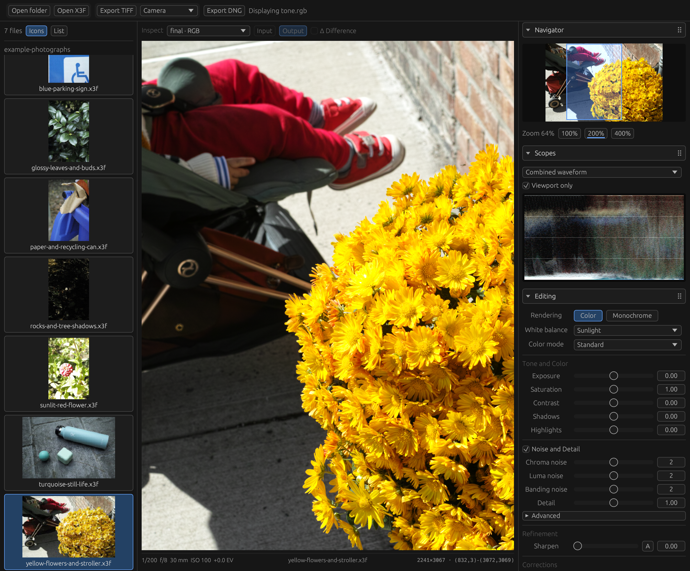

# Foveonic


A photo editor for Sigma X3F files, focused on speed, flexibility, and attractive results. Edit individual photographs or process a whole batch. This is not a hand-made project.



## What you can do

- Work with Sigma's older SD and DP cameras, Merrill, Quattro, and Quattro H.
- Adjust exposure, colour, highlights, noise, and detail while keeping your original files untouched. Edits save automatically alongside your photographs.
- Start with Natural or Strong adaptive tone, bring out detail with dehaze, and save crops with preset or custom aspect ratios. Straighten a horizon or rotate freehand, with automatic cropping to keep corners inside the photograph.
- Rate, search and compare photographs, save editing presets, and adjust a subject's colour by dragging directly on the image.
- Create black-and-white images by mixing the original sensor layers, rather than simply removing colour from the finished image.
- Browse and edit Merrill, Quattro and Quattro H photographs with responsive Smart previews. Start with a smaller preview and zoom in for full detail. Quattro refines the visible area first while the rest of the image finishes in the background.
- Export finished photographs or prepare them for further editing in another application.

## Finished photographs or DNG?

**TIFF, JPEG, PNG and JPEG XL** bake in your adjustments for a finished photograph. TIFF offers uncompressed, LZW and ZIP output. PNG and lossless JPEG XL can preserve the full 16-bit rendering. JPEG XL also offers lossy compression and adjustable encoding effort for smaller archives.

**DNG** leaves more flexibility for further editing in a raw editor. Some processing is still baked in, and other editors may interpret the colours and tone differently. DNG export is experimental.

## Get Foveonic

Download the Mac app from the [latest release](https://github.com/hank-bond/foveonic/releases/latest). The app targets Apple Silicon Macs running macOS 15 Sequoia or later. Interactive Sequoia compatibility awaits feedback from users running macOS 15.

The app isn't notarized, so macOS may block the first launch. Use **System Settings → Privacy & Security → Open Anyway** for Foveonic.

Want to try it out? Download a photograph from the [example collection](https://github.com/hank-bond/foveonic/releases/tag/example-photographs), then open the file or its folder in Foveonic.

See the [changelog](CHANGELOG.md) for what's new.

## Command line

From a source checkout with Rust and Cargo installed:

```sh
# Export a TIFF
cargo run --release -p foveonic -- render photo.x3f photo.tiff --wb Sunlight --mode Standard

# Export a DNG for further editing
cargo run --release -p foveonic -- export-dng photo.x3f photo.dng --wb Sunlight --mode Standard
```

These examples use daylight white balance and the Standard colour mode. The command line does not load edits saved in the GUI. Use a new output filename for each export.

## Build the Mac app

You'll need macOS 26+, Rust 1.88+ with Cargo, and Xcode 26+ with its command-line tools selected. From the repository root:

```sh
cargo xtask bundle
```

The app is created at `target/release/Foveonic.app`. To build and launch it instead, use `cargo xtask run`.

## License

Foveonic is licensed under the [GNU Affero General Public License, version 3](LICENSE). Third-party components retain their own licenses and notices.
