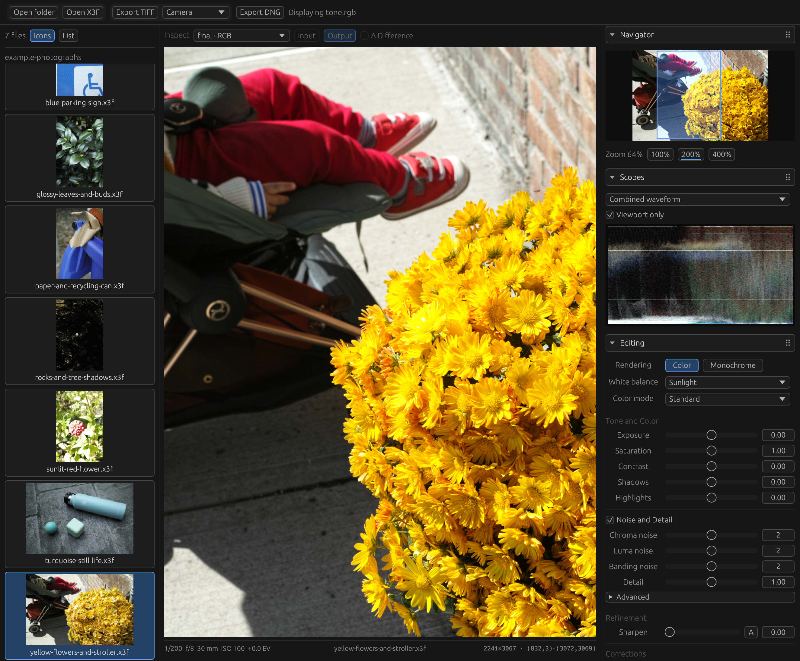

# Foveonic

An X3F processing app with both a GUI and a batch CLI, focused on processing speed, flexibility, and attractive results.  This is not a hand-made project.

----



## Supported Formats
TIFF exports bake all processing into the pixel data, trading maximum compatibility for reduced editing latitude.  This is because tone and color changes are fully baked-in, with downstream editors operating "on top of" those changes.

DNG separates out the base linear image data—only baking in some corrections and detail enhancement—and compresses all tone and color changes into a curve and matrix in the DNG metadata.  Your DNG editor will then take this metadata and apply it on top of the linear pixel data as part of its rendering pipeline.  This makes it a more flexible format for editing further, but does mean that not every editor will render it exactly as it looked in Foveon upon export.

Classic rendering covers the pre-Merrill SD9, SD10, SD14, SD15, DP1/DP1s/DP1x and DP2/DP2s/DP2x family through shared display, TIFF and editable DNG output. Decoding supports both older interleaved originals and format30. Low- and high-ISO recipes share calibration, detail, presentation and export machinery. Classic monochrome uses the reference-derived camera mixture. Color modes remain available, while ordinary WB is inactive. Custom noise sliders remain unavailable. DNG embeds an approximate photographic appearance.

Original-file validation currently covers eight models, including a DP2x ISO50–3200 ladder. DP1x and DP2s use recovered processing contracts but still need genuine originals for validation. See [Classic rendering](docs/specs/classic-rendering.md) and the [coverage evidence](plans/classic-coverage.md).

Quattro decoding and sensor-plane inspection expose low-resolution RGB and full-resolution blue separately. Ordinary full-size DP0, DP1, DP2, DP3 and sd Quattro recipes support display, TIFF and editable DNG with ten camera color modes, editable white balance, exposure, contrast, shadows, highlights, saturation, chroma and luminance noise, native Smooth/Crisp detail, signed sharpness and highlight recovery. Saved file adjustments provide initial settings. ISO100 originals pass complete native comparisons across all five models, with additional ISO800 coverage for the high-ISO route. Dedicated monochrome adds channel mixing, its own reconstruction and response, and independent noise and Smooth/Crisp controls. Banding adjustments remain disabled. Quattro DNG bakes a canonical Standard technical base and embeds an approximate selected appearance through shared export machinery. See the [DNG validation](plans/quattro-dng.md). The sd Quattro H uses the separate [Tiger route](docs/specs/tiger-rendering.md) with calibrated digital gains, dynamic-range extension and adaptive reconstruction. Tiger supports Full color and monochrome rendering, inspection, TIFF, editable DNG and the shared decode cache. Tiger color previews also support Fast and Smart.

Quattro rendering and blue-map inspection use bundled calibration maps with [recorded provenance and file hashes](crates/foveonic/assets/quattro/README.md). The GUI and CLI need no calibration setup or installed reference application. An explicitly supplied calibration directory can override the bundled maps. Each engine retains an immutable resource snapshot.

## Rendering Techniques
All correction and enhancement metadata that exists in the X3F file is made use of.  Effort has been made to align with the Sigma's intended processing of the files wherever possible.  Additional controls are made wherever available to alter the processing approaches on a per-image basis.

The processing pipeline has been largely developed using WebGPU shaders, in order to provide a significantly improved editing experience.  This also benefits batch CLI render times.

Choose **Color** or **Monochrome** in the editor. Merrill monochrome mixes the original sensor layers with a triangular R/G/B selector before dedicated filtering steps.  This is different from using a monochrome mode in your editor becuase it operates on the sensor layers *before* they are converted into RGB space.  The primary benefit is that you can use just Layer 3 (B) which has a much better signal-to-noise ratio than the others.

Monochrome DNG bakes the mix into linear neutral samples while keeping exposure and tone in metadata.

Merrill highlight correction offers **Classic** (default), **Color Field: Local**, and **Color Field: Global**. Classic retains its threshold control. Local uses 64 local brightness sweeps, while Global solves globally for finer gradients at higher cost. Method comes first, followed by a shared Highlights slider and enable checkbox. Classic retains A. Both Color Field methods default to 0, preserving the original reconstruction, without a redundant A button. Increasing selectivity from 0 toward 1 rejects more inconsistent evidence without increasing the original neutral weights. See the [comparison workflow](docs/color-field-evaluation.md).

## Requirements
Development is currently done on a modest Apple M1 Pro with 14 GPU Cores.  The current focus is targeting MacOS.  The tooling chosen should be multi-platform compatible, but focus is not currently on delivering that.  On a machine of that caliber, you may expect Merrill full pipeline render times around 900-1600ms, with partial re-renders closer to 200-400ms using cached pipeline partials.

Expect application memory to average around 2GB, with transient operations peaking under 4GB.  Configuration to reduce memory requirements at the cost of increased processing speed will be made available at a later time.

## Build and use

For the macOS app, use macOS 26+, Rust 1.88+ with Cargo, and Xcode 26+ with its command-line tools selected. Run these commands from the repository root.

### GUI

Build and launch with an X3F file or folder:

```sh
cargo xtask run -- path/to/photo.x3f
```

This creates `target/release/Foveonic.app` without installing it. Use `cargo xtask bundle` to build without launching, or add `--debug` before `--` for a debug build. Custom Cargo target directories are respected. Omit the input to reopen the last folder. Select a photograph, adjust its settings, and use **Export TIFF** or the experimental **Export DNG**. Edits save automatically in a visible `foveonic` subfolder beside the originals. Existing adjacent sidecars move there on their next save. Thumbnails follow completed renders, and larger previews are prepared asynchronously in the temporary image cache.

Ordinary Quattro and Tiger color photographs offer **Full**, **Fast** and **Smart** preview choices. Smart shows Fast first, refines the clicked detail viewport above 100%, then completes the whole Full frame for panning. **Settings** configures a temporary decoded-source disk cache, enabled by default with a 10 GB budget for Quattro and Merrill. Classic caching defaults off. The open folder decodes ahead while photo work is idle. Muted dots beside filenames show disabled, queued, ready and uncached sources.

### CLI

Render a color TIFF:

```sh
cargo run --release -p foveonic -- render path/to/photo.x3f output.tiff --wb Sunlight --mode Standard
```

Render Merrill blue-layer monochrome, or export its linear DNG:

```sh
cargo run --release -p foveonic -- render path/to/photo.x3f mono.tiff --wb Sunlight --mono-mix 0,0,1
cargo run --release -p foveonic -- export-dng path/to/photo.x3f mono.dng --wb Sunlight --mono-mix 0,0,1
```

For Merrill, `--rendering monochrome` selects the equal-layer mix. `--mono-noise` and `--mono-banding` select presets 0–4. Estimated ISO above 6400 is currently unsupported for monochrome column correction.

For Classic monochrome, select the rendering mode and desired color mode:

```sh
cargo run --release -p foveonic -- render path/to/classic.x3f mono.tiff --rendering monochrome --mode Standard --reconstruction
```

TIFF exports accept `--tiff-color-space srgb`, `adobe-rgb`, or `prophoto-rgb`. Omit it to preserve the camera's stored space, falling back to sRGB when none is recorded. Use `--sharpen auto` for camera-derived sharpening or a numeric amount for manual sharpening. Classic and Merrill sharpening defaults to Off. Quattro uses the saved sharpness value or zero, which retains its baseline proportional detail.

Add `--size 600x400` to resize a TIFF export to exact dimensions using reference photographic resampling. This also works for TIFF batches. Omit it for native dimensions.

The output file must not already exist. Use `cargo run --release -p foveonic -- --help` for batch processing and other options. The CLI does not load GUI editing sidecars.

Sample X3Fs are available in the [Example photographs release](https://github.com/hank-bond/foveonic/releases/tag/example-photographs). Download a photograph and open it in the GUI to try the app.

## Releases

Release-tag pushes build an unsigned Apple Silicon app for macOS 26+ and attach it to a draft GitHub Release. See the [changelog](CHANGELOG.md) and [release checklist](docs/releases.md). Publication remains manual.

## Checks

```sh
cargo test --offline --workspace
cargo clippy --offline --workspace --all-targets -- -D warnings
cargo fmt --all -- --check
cargo run --offline -p docs-index
cargo run --offline -p docs-index -- --check
```

Run GPU and original-file tests serially with `FOVEONIC_FIXTURE_DIR` pointing to the local X3F fixtures:

```sh
FOVEONIC_FIXTURE_DIR=path/to/x3f cargo test --offline --release --workspace -- --ignored --test-threads=1
```

Classic original-file checks additionally use `CLASSIC_X3F`, `CLASSIC_DECODED_REFERENCE`, `CLASSIC_CORRECTION_REFERENCE` and `CLASSIC_COLOR_REFERENCE`. Set `CLASSIC_REFERENCE_DIR` for the composed reference comparison and `FOVEONIC_LOG_CAPTURE` for the complete FIR boundary. These are local research inputs. Bounded numerical fixtures are checked in.
