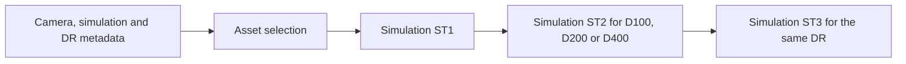

# Fujifilm dynamic range and film rendering research

The owner wants visually comparable dynamic-range handling and film looks for X3F-derived DNGs. Numerical identity with Fujifilm or the studied film-rendering chain is unnecessary. This document records evidence and candidate approaches. It does not authorize a new processing implementation or change the existing [output contract](./specs/output-strategies.md).

## Capture headroom and rendering are separate

Fujifilm's DR200 and DR400 modes reserve additional highlight headroom during capture and use rendering to restore darker tones. The advertised extensions correspond to one and two stops. They require higher selected ISO settings relative to base ISO. The exact capture exposure and amplification depend on the camera and shooting settings. [Fujifilm's explanation](https://www.fujifilm-x.com/en-gb/learning-centre/boost-dynamic-range-in-your-images/) describes deliberately underexposing to protect highlights and brightening the lower tones during JPEG processing.

The useful software concept is to place ordinary tones while compressing the brighter range into the output. A rendering curve cannot restore sensor information already clipped. Sensor reconstruction remains a separate task.

For an ETTR Merrill file, the placement step may require lowering Exposure. Applying a mandatory positive one- or two-stop adjustment would not reproduce this workflow. The available headroom and desired midtone placement must be established before choosing the rendering response.

## Film-rendering evidence

The ARM64 film-rendering study combines bounded instructions and pseudocode, metadata inventories, selected assets, native probes and measured responses. Later film-rendering redesigns were not inspected.

### Real metadata

A read-only filename inventory found 17,110 RAFs on the owner-authorized Catalog volume. A stratified sample inspected up to twelve filenames per non-Trash folder, capped at 512 files. It includes X100V, X-T5, X-T3, X-E4 and X-M1 photographs.

| Effective DR setting | Sample count | Observed RAF raw exposure bias |
| --- | ---: | ---: |
| DR100 | 408 | −0.72 EV |
| DR200 | 32 | −1.72 EV |
| DR400 | 72 | −2.72 EV |

All sampled effective DR values agree with those biases. Effective DR combines the explicit development setting and Auto Dynamic Range. Twenty-eight DR200 samples came from Auto. The common −0.72 EV offset is part of these files' baseline convention. It is not an additional creative exposure adjustment to copy into X3F processing. These photographs establish metadata coverage, not a controlled same-scene exposure bracket.

### Metadata dispatch and gain handling

`CFujiRAFImageRep::GetDynamicRangeSetting` reads the maker-note DR mode and then the automatic or explicit DR value. It also has a RAF raw-exposure-bias fallback and camera-specific low-ISO cases. The inspected code recognizes additional cases such as 50 and 800. The simulation asset selector caps its DR asset suffix at 400.

`GetFilmSimulationGain` handles raw and film exposure-bias metadata, an additional private gain factor and an 800-specific adjustment. The shared exposure-gain helper has a dedicated simulation branch, and both ordinary Exposure and spatial HDR setup consult it. These findings make double compensation a real integration concern. The complete RAF decode-to-render normalization was not reproduced, so the scalar helper alone must not be transplanted into our sensor pipeline.

### Simulation selection is a processing chain

`SettingsToSettingsExFujifilmSim` resolves the simulation name, maps the camera to a simulation asset family, reads DR, and constructs three asset names. The native factory loads and joins their transforms:

Camera names and asset families are not identical. The inspected X100V and X-E4 methods select the FujiXT3 family. X-T5 and X100VI select FujiXH2. This explains why newer camera curve descriptors can exist without equally named three-stage assets.

The factory wraps the assets in defined color conversions. Its source table 5 is encoded device RGB with a gamma-1.8 convention. It converts to the internal Fujifilm representation before the assets, then converts their Adobe RGB 1998 output to the requested destination. These identities were checked against the built-in transform headers. They are not scene-linear sRGB or Sigma sensor-layer coordinates.

The inspected DR simulation chain is pointwise and selected from metadata. It is not the spatial HDR slider algorithm automatically analyzing this photograph. Manual spatial HDR remains a separate operation. Settings preparation also derives a 17-point neutral curve from the complete transform. That sampled curve does not describe all of its color behavior.

### Native response measurements

The retained probe invokes the original C++ factory and RGB-buffer method in an isolated process using the reviewed ABI. It checks the installed library hash, buffer status, response count and finite outputs. Tests cover 257 neutral samples and 240 colored samples per chain. The model families include those selected by the sampled X100V and X-T5, plus older and newer representative families. The retained manifest records 228 chain configurations and 113,316 RGB output samples. These are separate from the earlier color-and-tone checks.

For one measured Provia family, these are mean encoded output RGB values at identical internal gray inputs:

| Internal gray input | D100 | D200 | D400 |
| --- | ---: | ---: | ---: |
| 0.0312 | 0.0221 | 0.0714 | 0.177 |
| 0.125 | 0.197 | 0.368 | 0.550 |
| 0.500 | 0.755 | 0.892 | 0.928 |
| 0.898 | 0.981 | 0.986 | 0.989 |
| 1.00 | 1.00 | 1.00 | 1.00 |

The measured response lifts lower inputs substantially while converging near white. The input is encoded device RGB, so input 0.125 must not be interpreted as a calibrated scene luminance. Actual DR captures also arrive with different raw normalization.

A factorial experiment swaps the D100/D200/D400 versions of ST2 and ST3 for Provia. Changing either stage changes the result. Mixed versions can produce large RGB excursions. Thus the DR-labelled stage pair should be studied together. The stage-isolation measurements below establish their mathematical forms. They do not uniquely separate authored camera calibration from creative color design.

The measurements establish available native responses. They do not establish full-photo equivalence, camera-neutral portability, grain, spatial processing or the perceptual quality of an X3F adaptation. No Foveonic pixels or default controls were changed during this research.

### Separating the stages

A second probe replaces selected assets with independently authored identity tables and omits the source/destination conversions when inspecting the internal chain. It also reads the live stage descriptions and deduplicates decoded tables. Inspection covers all 222 matching-DR chains from the original measurements. The six deliberately mixed-DR chains are excluded from this inventory.

| Part | Measured representation | Dependence in the inspected families |
| --- | --- | --- |
| Input conversion | Shared one-dimensional encoding conversion. | Identical across the measured chains. Its source still uses the device-RGB convention described above. |
| ST1 | 33 × 33 × 33 RGB table, with 16-bit node values. | Changes with camera family and simulation. Identical across DR100/200/400 for each camera/simulation pair. |
| ST2 | Runtime curve with 16,384 entries, applied independently to each channel. | Identical R/G/B curves. Changes with simulation and DR. Cross-camera differences for the same simulation/DR never exceed one 16-bit output code. |
| ST3 | RGB table, usually 17 × 17 × 17. Fourteen inspected chains use 33 × 33 × 33. | Changes with camera, simulation and DR. |
| Output conversion | Shared transfer and color-space conversion. | The same requested output basis across these measurements. |

All inspected ST2 curves are nondecreasing. The runtime entry count does not establish how many points were used to author a curve. Eterna's curve has a raised black endpoint, illustrating that creative tonality is present in this stage as well as dynamic-range handling.

ST1 cannot be labelled camera calibration alone. Selecting another simulation on the same camera changes it. ST3 also carries camera dependence. The measurements therefore support a reusable tone operation surrounded by color transforms, but do not supply a single camera-only table that can be cleanly removed from every look.

An independent evaluator reconstructs the internal three stages using tetrahedral interpolation of the color tables and linear interpolation of the channel curves. Against the native evaluator, its maximum absolute channel difference is approximately 0.00000149 over 222 configurations and 110,334 RGB samples in the unit input cube. This verifies table evaluation using the same measured assets. It does not establish an independently authored film look or an end-to-end raw rendering match.

### What changes between DR responses

To compare DR handling separately from each simulation's baseline contrast, define its D100 curve as `T100` and its selected curve as `TD`. Within a monotone interval, the equivalent baseline input is `T100_inverse(TD(x))`. This is a useful mathematical decomposition, rather than proof that the inspected chain internally authors its curves this way.

For Provia, the measured equivalent-input ratios are:

| Internal ST2 input | D200 relative to D100 | D400 relative to D100 |
| --- | ---: | ---: |
| 0.010 | 2.05× | 4.09× |
| 0.030 | 2.05× | 4.02× |
| 0.125 | 1.86× | 2.90× |
| 0.500 | 1.23× | 1.34× |

The lower-input response is close to doubling or quadrupling, with progressively less lift toward white. Velvia, Classic Chrome, Classic Negative, Eterna and Reala Ace show the same broad structure with different transitions. A common gain-and-shoulder operation configured by a look is a reasonable reconstruction candidate. A single recovered curve is not an exact universal response for every simulation.

These ratios use the internal ST2 coordinates. They are not calibrated scene-exposure measurements. The raw gain conventions, input conversion and ST1 remain part of the complete rendering. In particular, selecting D400 on an unchanged input does not model the lower exposure of an actual D400 capture.

### DR differences across camera families and simulations

A follow-up expands the inventory to all seven packaged asset families: FujiGFX100, FujiGFX100II, FujiGFX50S, FujiXH1, FujiXH2, FujiXH2S and FujiXT3. It covers 396 matching-DR chains representing 132 camera-family/simulation combinations and twenty distinct simulation names. An asset family is a processing group, not proof of a particular sensor-generation boundary.

DR100 is the baseline DR setting for each simulation. It already contains that simulation's ordinary tone and color rendering. The useful comparison is therefore D200 or D400 against the same simulation's D100, rather than against a linear image or another simulation.

The expanded measurements retain the earlier result: for the same simulation and DR setting, cross-family ST2 differences never exceed one 16-bit output code. ST1 remains unchanged across DR settings for every camera-family/simulation combination. The DR tone response is effectively shared across the tested camera families.

Factoring out each simulation's D100 curve also shows that the relative DR response varies with the simulation. For example, at internal ST2 input 0.500, Provia's D200 and D400 responses correspond to D100 input multipliers of 1.23 and 1.34. Reala Ace gives 1.34 and 1.45. These are internal-coordinate comparisons, not scene EV or a brightness offset to add to pixels. The lower-tone lift and highlight convergence are shared ideas, with simulation-specific transition shapes.

ST3 requires more care. The follow-up samples `ST3_Dn(p) - ST3_D100(p)` at 343 common interior RGB coordinates for each combination. Most cross-family comparisons differ, so the packaged DR color adjustment is not one identical additive table correction across cameras. However, these numeric coordinates have not been established as the same calibrated scene color for every family. This comparison cannot prove that the underlying camera-normalized DR color operation needs a distinct algorithm per generation.

The supported conclusion is that DR tone shaping varies by simulation and is effectively shared across camera families, while the surrounding DR color tables remain coupled to camera and simulation. Our reconstruction can explore a shared headroom response with look-specific parameters, then evaluate whether color compensation is needed in our own calibrated basis.

### Color, headroom and signed values

An identical curve applied separately to R, G and B preserves neutral grays, but generally changes the ratios between unequal channels. It is not a luminance-only or constant-hue operation. The color tables before and after it form part of the complete appearance. This provides a concrete reason to evaluate tone and color together, even when their controls and configuration are separated.

The reviewed 16-bit 3D-table evaluator normalizes a value above its unit cube by the largest positive channel, evaluates the table, then restores that scale. Negative components are clipped for the table lookup. That behavior is specific to this transform evaluator. It is not highlight reconstruction or a complete signed scene-linear policy.

A further 21-chain boundary probe evaluates 11,193 RGB samples, including negative channels and values above one. The native outputs remain finite in that test, but agreement with the higher-precision evaluator is much worse outside the unit domain, reaching approximately 0.0297. An isolated check traces a discrepancy to single-precision endpoint extrapolation of the channel curve. Large interpolation weights subtract nearly equal terms. This is evidence against assuming that the recovered chain is a numerically robust arbitrary-headroom operation. It is not evidence of an ordinary photograph exhibiting that discrepancy.

Our reconstruction should explicitly define its working basis, exposure reference, negative-value treatment and shoulder domain. The studied device coordinates and lookup clipping do not settle those choices for Foveon. Existing sensor highlight reconstruction remains upstream of the proposed photographic rendering.

## Film simulation scope

The studied simulation choice changes both tone and color, with an additional profile applied internally. A tone curve or saturation setting alone is insufficient.

The retained native measurements cover twenty named variants across the inspected families, including monochrome filter variants. The following groups provide useful photographic targets. Descriptions summarize [Fujifilm's image-quality guide](https://fujifilm-dsc.com/en/manual/x-t5/menu_shooting/image_quality_setting/), rather than claiming these qualities were independently rated on X3F photographs.

| Family | Character to evaluate |
| --- | --- |
| Provia | General-purpose baseline. |
| Velvia | Vivid color and a stronger landscape look. |
| Astia | Softer rendering. |
| Pro Neg. Standard / High | Portrait gradation with different contrast. |
| Classic Chrome | Subdued color and stronger shadow contrast. |
| Classic Negative | Harder tonality and a distinctive color palette. |
| Nostalgic Negative | Amber highlights and rich shadows. |
| Eterna / Bleach Bypass | Cinema-oriented softness, or low saturation with strong contrast. |
| Reala Ace | Faithful colors with firm tonality. |
| ACROS / Monochrome / filters / Sepia | Monochrome tone and color sensitivity, with optional tint. |

White-balance shifts, highlight/shadow settings, Grain, Color Chrome and Color Chrome FX Blue are separate camera controls. A custom camera recipe can combine them with a simulation. A pointwise color transform does not reproduce texture or every such setting.

## Camera-independent decomposition

The owner's intended approach is to recover the processing responsibilities, reconstruct shared operations and configure the input through a compatibility profile. Foveon is the current input. The possibility of other raw formats frames the separation of responsibilities without adding a decoder or a raw-format roadmap.

| Component | Responsibility | Compatibility information |
| --- | --- | --- |
| Input preparation | Produce calibrated RGB in a declared linear basis while retaining signed values and headroom. | Source reconstruction, calibration, white balance, primaries and code units. Existing camera-specific noise handling stays here. |
| Exposure normalization | Translate file conventions into a documented exposure reference exactly once. | Baseline gain, recorded compensation, relevant capture-mode metadata and calibrated defaults. |
| Scene placement | Estimate a useful midtone level and usable brightness range, with user overrides. | Optional capture-headroom and noise-floor hints. Missing hints require image estimates or explicit defaults. |
| Dynamic-range rendering | Shape toe, midtone contrast and highlight shoulder using common photographic parameters. | A profile can configure anchors, useful ranges and defaults without changing the meaning of the operation. |
| Creative appearance | Apply the chosen tone response and smooth hue/saturation/brightness mapping. | The camera-specific calibration must be separated from the look or accounted for during fitting. |
| Output representation | Render a preview/TIFF or encode the selected DNG appearance. | Destination profile, output range and receiving-editor behavior. |

A compatibility profile should describe quantities, units and conventions rather than reproduce a manufacturer's tag structure. Values need an origin such as recorded metadata, calibrated profile data, image estimate or user override. Unknown information must remain distinguishable from a measured zero. Nominal rendering white, sensor clipping and output white are separate anchors.

The profile and photo analysis serve different purposes. A profile records stable input behavior. Analysis estimates what this photograph needs. Keeping those separate avoids treating a metadata default as proof that a scene needs a particular compression strength.

### Mapping to the current X3F input

The existing [shared linear-edit context](../crates/foveonic/src/render/recipes/linear_edits.rs) already receives working primaries, nominal white and geometry from the camera recipe. That is a useful existing boundary to extend only as actual processing work requires.

| Recovered input | X3F interpretation |
| --- | --- |
| Encoded device RGB used by the simulation chain | Map from our already reconstructed and calibrated RGB through an explicit working-space/encoding conversion. Do not treat Foveon layer values as those device coordinates. |
| Raw exposure-bias and simulation-gain conventions | Establish our own documented normalization from the existing camera recipe. Fuji's numerical offsets are not Sigma defaults. |
| DR capture instruction | No equivalent has been established in the current X3F parser. Use a chosen rendering intent or an image-derived estimate rather than inventing a recorded DR mode. |
| ISO, shutter, aperture and exposure compensation | Our [EXIF reader](../crates/foveonic/src/x3f/exif.rs) already parses these when present. They can inform analysis but do not uniquely determine scene brightness or artistic intent. |
| Recorded photographic adjustments | [CaptureAdjustments](../crates/foveonic/src/source.rs) contains optional file settings. Recorded editing Exposure and capture exposure bias must be distinguished before using either for normalization. |
| Capture saturation and black references | Use values established by the source's technical processing, with separate definitions for rendering white and clipping. |

Other camera modes may require different metadata translations. Their names alone do not establish an equivalent DR mechanism or a manufacturer partnership. The shared operation should consume the normalized photographic meaning established for the input.

### Reconstructing the operation

Start by separating the film-rendering chain's calibration, exposure convention, tone response and color mapping. Measure them in declared domains, then choose a useful shared response. The native probes now establish the individual mathematical stages and their camera/DR dependence. They do not uniquely separate camera calibration from creative color design inside the RGB tables.

For dynamic range, test a global response with a clear midtone anchor and controlled shoulder/toe before adding scene-dependent spatial behavior. Reuse the existing HDR guide if photographic evidence later requires local adaptation. A combined tone/color response may be needed to preserve the relationship between dynamic-range rendering and the creative look. Component boundaries do not require separate full-image passes or imply that operations commute.

For film-inspired looks, compare renderings in a common calibrated color basis. Relative measurements against a target appearance can help fit our own tone curve and smooth color table. If Provia is the comparison baseline, account for its own tone response to avoid applying contrast twice. The film-rendering chain's Fujifilm input calibration is not a replacement for our Foveon calibration.

Photographic evaluation should include skin, foliage, blue sky, saturated objects, artificial lights and ETTR highlights. Use whole-frame and crop toggles. Evaluate neutral stability, midtone placement, hue changes near the shoulder, shadow noise and saved/exported appearance. Metadata inspection and synthetic ramps do not replace this review.

## DNG representation

DNG provides tone curves, color look tables and optional additional camera profiles. A profile look table is applied after exposure/fill-light processing and before the tone curve. A global pointwise approximation is a plausible fit for these profile mechanisms. Spatial adjustments or grain require additional processing rather than a static color table. See the [Adobe DNG specification](https://helpx.adobe.com/content/dam/help/en/camera-raw/digital-negative/jcr_content/root/content/flex/items/position/position-par/download_section_733958301/download-1/DNG_Spec_1_7_1_0.pdf).

Our writer already emits `ProfileToneCurve`, `ProfileLookTableData`, its dimensions/encoding, and an appearance name. Our agreed [output strategy](./specs/output-strategies.md) currently carries one selected appearance per DNG. A first prototype could therefore choose the look in Foveonic and export it using the existing profile boundary. Multiple selectable looks inside one DNG would require a separate product decision.

Receiving-editor interpretation needs explicit testing. A profile-based rendering retains more editing latitude than baking the entire appearance into samples, but it does not guarantee identical appearance in every application. For a visually comparable result, fit and validate the proposed tone/color model through the receiving editor as well as our own preview.

## Next experiment

The next photographic research step is to establish a common calibrated input basis, account for normalization, and compare an independently parameterized tone response with color mapping enabled and disabled. The recovered table structure supplies the mathematical decomposition. Camera-neutral color fitting remains unresolved. A later Foveon experiment can compare a neutral baseline and two wide-range responses, followed by restrained and vivid appearances. No Fuji decoder or future raw-format implementation is planned by this document. The present work is research only. The existing saturation, Advanced Color Range and inversion prototypes remain separate.
