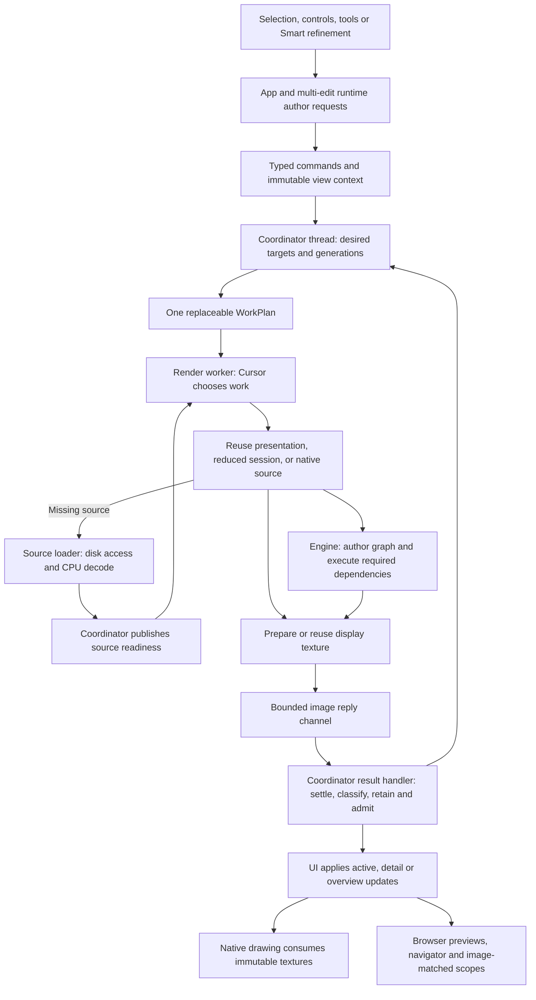
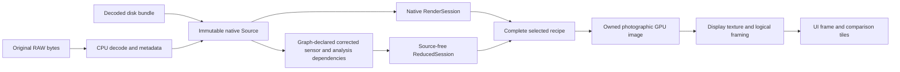

# Interactive rendering architecture

This is a code-based map of the current implementation, including diagnostics and idle Thumb preparation. It describes who makes each decision and who retains each resource. It does not establish conformance for every combination of interactions. Required behavior lives in [interactive rendering](./specs/interactive-rendering.md), [multi-edit](./specs/multi-edit.md), [small previews](./specs/small-previews.md) and [diagnostics](./specs/performance-diagnostics.md). The [latency investigation](../plans/multi-edit-latency.md) retains earlier measurements and stabilization evidence.

The [architecture guide](./architecture/AGENTS.md) routes shared principles, vocabulary and open questions. The [orchestration proposal](./specs/render-orchestration.md) records agreed goals and provisional boundaries, separate from this implemented-code map. The [render runtime migration](../plans/render-runtime.md) is the active plan for owner-reviewed conceptual changes.

The [coordination consistency inventory](../plans/render-coordination-consistency.md) records the broader source audit and contract questions to review before selecting incremental cleanup slices. Its findings are structural observations unless runtime evidence is stated explicitly.

## Request and delivery flow

The processing and presentation paths are alternatives. Reframing compatible pixels can skip photographic execution. A reduced-session hit can skip source loading and reuse graph dependencies, while still executing a changed finishing operation. A decoded disk hit skips original-file access and entropy decoding but can require all native preparation before pooling.

The entry points are `App::select`, `submit_with_quality`, `receive` and `update` in [main.rs](../crates/foveonic-gui/src/main.rs), and `sync_multi_edit` / `submit_multi_edit` in [multi_edit_runtime.rs](../crates/foveonic-gui/src/multi_edit_runtime.rs). The UI sends typed commands and immutable view context through [runtime.rs](../crates/foveonic-gui/src/rendering/runtime.rs). Its dedicated coordinator thread receives worker results, calls `handle_result` and publishes the next plan independently of UI paints. The UI rechecks returned `ResultUpdate` facts against its latest edits and view before application.

Result handling settles the matching request, classifies reuse, retains useful pixels and checks source/revision admission as one operation before publishing the resulting plan. Allowed photo feedback survives image rejection. The UI applies progress/opening/export state and acknowledges Active image delivery. Request publication is nonblocking with respect to queue capacity. The coordinator reads queued commands in batches, so per-photo replacement and coalescing happen before another plan is exposed. UI status reads use the last observed immutable snapshot if publication is in progress.

[request.rs](../crates/foveonic-gui/src/rendering/request.rs) owns the immutable request data, consumer-purpose classification and preview geometry policy. The coordinator derives target identity from the request's purpose. The worker applies its preview policy after resolving camera controls and chooses the corresponding execution resources. Foreground preview resolution and idle preparation share camera-aware scale selection through processing capabilities. Reusing a framing plane can still preserve an already-rendered grid instead of applying a new preview scale.

## State and ownership

| Concept | Current owner | Boundary |
| --- | --- | --- |
| Browser membership | `Browser` | Determines which photographs appear and the scope of file operations. It is independent of the bounded editing subset. |
| Viewport editing subset | [viewport_selection.rs](../crates/foveonic-gui/src/viewport_selection.rs) | Pointer interaction changes the editing targets. Photograph tools use those targets without owning selection. |
| Requested edits | `App::settings`, `Runtime::photos`, `sidecars::Session` | Mutable representations are synchronized between active controls, per-photo editing state and persistence. There is currently no single container holding all three roles. |
| Desired render work | [RenderCoordinator](../crates/foveonic-gui/src/rendering/coordinator.rs), run by [runtime.rs](../crates/foveonic-gui/src/rendering/runtime.rs) | Owns task identity, replacement/coalescing, settlement and admitted revision order per photo and purpose on the coordinator thread. |
| Request purpose and preview policy | [request.rs](../crates/foveonic-gui/src/rendering/request.rs) | Describes requested work independently of worker execution. Consumer purpose, nominal scale, camera-resolved scale and actual reused grid remain distinct. |
| Numeric editing values and reset values | [render/edits.rs](../crates/foveonic/src/render/edits.rs) | The processor derives snapshots from camera metadata and requested settings. The worker adds render-produced estimates and publishes them. Multi-edit retains/applies them without owning camera interpretation. |
| Execution service order | `Cursor` and the [render worker](../crates/foveonic-gui/src/rendering/worker/mod.rs) | Cursor preserves service across plan replacements. A job that needs source data defers without settling, allowing other ready jobs to execute. The worker retains processing sessions and prepares presentation resources. |
| Requested source acquisition | [source_loader.rs](../crates/foveonic-gui/src/rendering/source_loader.rs) | The coordinator retains wanted loads and admits one active or unconsumed decoded source. A separate I/O thread opens the existing decoded cache or original. Decoding uses the existing shared CPU pool. The renderer consumes the bounded handoff, then builds its processing session. |
| Recipe and numerical validity | [recipes](../crates/foveonic/src/render/recipes/AGENTS.md), [graph](../crates/foveonic/src/graph/AGENTS.md), [interactive.rs](../crates/foveonic/src/interactive.rs) | Recipes describe operations. Effective operation keys and dependency versions determine reuse. The executor runs required missing work. |
| Visible image | `App::frame`, `App::detail`, `Runtime` frames | UI-owned immutable completions. Their requested settings and pixel provenance remain separate from newer controls. |
| Shared retained-memory policy | [render/memory.rs](../crates/foveonic/src/render/memory.rs) | The UI inventories its resources. The coordinator publishes retained-image handles, which the worker combines with the frontend inventory for core accounting and trimming. Essential active inputs can exceed the target. |
| Cross-worker priority | [background.rs](../crates/foveonic/src/background.rs) | Shared demand counters and interruption epochs govern participating I/O, CPU and GPU checkpoints. It is not a hardware GPU priority queue. |

`sidecars::Session` owns asynchronous recipe restoration and persistence policy. `CachedRecipes` is an immutable bounded snapshot used by idle preparation, rather than another sidecar reader. The active edit and multi-edit runtime still exchange requested values through explicit synchronization calls.

## Data representations and caches

Disk and memory caches retain different representations. They cannot share one readiness flag or be treated as equivalent hits.

| Retained data | Owner and validity | Release or admission policy |
| --- | --- | --- |
| Original bytes, native decoded samples, selection metadata and disk previews | [decode_cache](../crates/foveonic/src/decode_cache/AGENTS.md). Verified file identity and format version. Preview validity also includes its recipe. | Separate disk budget, neighborhood preference and file recency. Green describes a complete local source bundle. |
| Decoded CPU samples for a live native photo | `RenderSession` holds an `Arc<Source>`. | Native session lifetime. A reduced session releases its source after sealing. A pending cache write may temporarily share it. |
| Immutable CPU preparation and scalar source statistics | `Engine` preparation caches and session-pinned preparation. | Bounded owners. Metadata, source and effective parameter identities govern reuse. These are separate from GPU checkpoints. |
| Native graph checkpoints | `RenderSession::cache`. | Retains successful edit restart inputs and optional alternatives within the graph cache limit. |
| Reduced inputs and editing checkpoints | `ReducedSession` inside [ReducedWorkingSet](../crates/foveonic/src/render/reduced.rs). GUI paths map to its session handles through [reduced.rs](../crates/foveonic-gui/src/rendering/worker/reduced.rs). | One active entry and byte-bounded inactive history. Speculative entries enter colder than actually used entries. |
| Whole-image presentation snapshots | Worker `Presentation`, plus coordinator-delivered `Snapshot` seeds. | Reuse compatible photographic pixels and display textures across reframing and retained target requests. These are budgeted image owners, not numerical dependency keys. |
| Delivered frames, queued replies, browser and navigator textures | GUI owners plus worker pending-image reservations. | The shared inventory counts distinct allocations. These references can keep storage alive after a processing entry is evicted. |
| Execution scratch | [gpu/scratch.rs](../crates/foveonic/src/gpu/scratch.rs) and guarded storage. | Reuse follows reader ownership and ordered submission. Retained immutable checkpoints are not available for scratch writes. |

The shared memory target is an accounting and retention policy, not a hard process or driver allocation limit. `Engine::trim_memory` trims optional versions, cold preparation and inactive entries. It protects essential active inputs and reports excess. Idle preparation uses spare capacity and checks admission before inserting a cold entry. Temporary source loading and reconstruction still require peak headroom.

Foreground source loads are coalesced by path independently of authored edits. Presentation and processing-session reuse are checked before requesting a source. Only the render job that actually found missing input waits for loading. A replacement request can still reuse GPU data. The coordinator receives source outcomes even when UI image delivery is full. Removed loads are discarded, and a ready source waiting for the renderer is included in retained-memory accounting. In-flight source reads can finish after their request becomes obsolete. Idle Thumb preparation still performs its cached-source access inside the existing speculative operation.

## Identities are for different decisions

| Identity | Meaning |
| --- | --- |
| `SourceOrigin` / verified file identity | Which immutable source the data belongs to. A path alone is insufficient. |
| `Target { path, purpose }` | Which requested result is being coordinated. Current, Before renditions, detail, inspection and export have different purposes. |
| `TaskId` | A coordinator generation for pixel work. Compatible presentation changes can retain it. |
| Task revision | Requested delivery/presentation version. It is used for exact settlement and admission ordering. A compatible older completion can still provide feedback. |
| Reduced session handle | A worker-local lookup handle. It does not establish numerical validity or replace source identity. |
| Graph version and effective operation key | Which numeric result can be reused, including upstream ancestry and working geometry. |
| Calibration signature and view context | Compatibility of a completion with the current processing and display context. |

Source identity, cache validity, task settlement and display acceptance are separate decisions. For example, a superseded completion can contain reusable compatible pixels without settling the newest request. A valid cached result can also belong to a photograph no longer visible.

[matching.rs](../crates/foveonic-gui/src/rendering/matching.rs) owns the shared settings and request comparisons used by Smart, presentation reuse, worker continuation, coordinator coalescing and delivery. Authored-edit equality ignores transient processing requests and range labels. Pixel-settings equality also ignores crop and rotation. Geometry equality checks crop, rotation and output size. Request comparisons add consumer context and quality/region requirements. They do not establish source identity, graph validity or permission to update a view. Those decisions remain with their existing owners.

## Scheduling and completion boundaries

There is one serialized interactive render worker, not one application-wide GPU producer. The UI, navigator, preview persistence and batch executor can also submit work to the shared ordered device queue. Compiled kernels and GPU storage mechanisms are shared through the engine/device interfaces. The CPU processing pool is separately sized from host logical CPUs, with bounded photo admission for speculative decoding.

The interactive worker's current service order is:

1. Apply pending memory configuration and handle stop/clear.
2. Serve a new color-pick task.
3. Take a frozen interactive export, one compatible follow-up, or the next image task from the fair cursor.
4. Analyze image-matched scopes when no image task is available.
5. Release foreground demand and attempt one idle preparation job, then recheck work or wait.

This ordering is implemented inside the worker loop. The coordinator's `WorkPlan` contains image tasks, scopes and picks. Memory commands, frozen interactive export and idle preparation configuration live alongside that plan in `Pending`.

The shared gate has a separate cross-worker priority order: interactive demand, browser thumbnails, requested batch processing, then optional background work. In-memory speculative decoding has its own documented thumbnail interaction while retaining foreground cancellation. A paused batch keeps its progress. A speculative attempt is invalidated by a foreground epoch change and retries later. Both policies use the same gate, but their lifecycles differ.

| Boundary | Implemented behavior |
| --- | --- |
| Recipe preparation and required graph operation | Advisory cancellation checks stop obsolete work at safe boundaries. The worker's compatibility predicate can allow useful same-edit continuation. |
| Cancellable graph operation | The executor already completes submitted work before advancing. Background submissions inside this scope defer their individual waits to that existing boundary through [gpu/scheduling.rs](../crates/foveonic/src/gpu/scheduling.rs). Early errors drain the outstanding stage. |
| Other background GPU submissions | The GPU facade retains its per-submission completion policy. These calls do not inherit a graph-stage completion boundary automatically. |
| Required photographic CPU readback | Waits for mapped data. The shared background readback helper polls cooperatively with foreground priority. |
| Main display preparation | The interactive worker waits for a newly prepared display texture before publishing its frame. Reused textures skip this wait. |
| Reply publication | Worker-to-coordinator and coordinator-to-UI image queues each hold at most two updates. The coordinator can hold one result between them. Crossbeam channel selection lets it keep processing commands while UI delivery is full. Status reads use immutable snapshots with a nonblocking UI read. |
| Navigator | The UI coalesces/defer requests while busy and briefly delays enqueueing so the main image can submit first. Its separate GPU thread uses ordered texture submission without a CPU completion wait. It does not use the shared gate. |
| Browser preview persistence | Immediate GPU thumbnails are retained separately from optional background downsampling/readback for disk persistence. Disk policy is checked before the optional handoff. |

GPU work already submitted is not preempted. These boundaries limit backlog and define when priority takes effect. They do not establish a fixed interruption deadline under arbitrary load.

Guarded ownership and ordered-queue reuse provide storage correctness independently of these completion waits. Waiting after an operation is currently a scheduling, cancellation and temporary-overlap policy. It is not what makes an immutable cached image safe.

## Where policy is distributed

These are source observations and review targets. They are not all demonstrated runtime defects.

| Decision | Current locations | Review concern |
| --- | --- | --- |
| Requested edit state | `App`, multi-edit `Runtime`, sidecar `Session` | Synchronization establishes precedence across three mutable representations. A new interaction must follow that precedence correctly. |
| Result handling | Coordinator `handle_result` owns settlement, invokes [delivery classification](../crates/foveonic-gui/src/rendering/delivery.rs), retains reusable pixels and performs source/order admission. The runtime publishes the resulting plan off the UI. `App::receive` checks current view compatibility, applies photo/view updates and acknowledges Active delivery. | Engine execution is serial. Runtime retention and Smart drawing enforce the validity of their held frames. |
| Effective execution request | `App::submit_with_quality`, `submit_multi_edit` and Smart choose intent. `Request` owns purpose, preview-scale application and reduced-session selection. Presentation reuse can retain the actual existing grid. | Request policy now has one home. Camera/default resolution and actual retained representation remain separate boundaries. |
| Cancellation | Worker foreground predicate, graph `Execution::check`, gate epochs, source/cache checkpoints and idle preparation predicate | Request obsolescence and priority interruption are distinct mechanisms. Their composition is intentional but currently implicit in nested closures and thread-local context. |
| GPU completion policy | Executor cancellation predicate and allocation window, background stage scope, GPU submission facade and display preparation | The presence of a cancellation predicate also selects per-operation completion waits. The recent background fix relies on that contract. An explicit completion policy would make this dependency easier to reason about. |
| Memory admission | GUI inventory, worker trimming, core graph/working-set limits and idle admission checks | The accounting is shared, while policy is applied at several resource lifetimes. Retained targets and physical peak memory are different quantities. |
| Speculative reuse | Idle preparation, decoded cache access and reduced cold insertion | GPU preparation does not promote reduced history. Its local source read uses ordinary `open_cached`, whose successful payload load updates disk recency. Access intent is not explicit across both caches. |
| Priority for auxiliary work | Shared gate, worker ordering, navigator enqueue policy and GPU facade | Not every GPU producer participates in the same gate. Request deferral and submission backpressure currently supply different parts of the priority behavior. |
| Preparation cost | Recipe authors, lazy descriptions, executor materialization and engine preparation caches | Graph reuse cannot suppress eager work done while authoring a graph. The row-correction fix moved materialization behind execution without changing its arithmetic. |
| Busy and progress | `App::busy`, coordinator settlement, `Pending::activity`, worker execution and progress tracker | These mean different things. Idle prewarming, pending foreground work and a displayed timer must not be inferred from one another. |

The numerical layer has clearer boundaries: camera recipes author graphs, operation identities determine validity, the executor selects dependencies, and processing nodes implement arithmetic. The largest orchestration concentration is still the GUI worker loop and its per-request closure. Extracting helpers without making the above policy explicit would move the nesting without resolving that concentration.

`Request::uses_reduced_session` checks explicit preview mode, final output, comparison and regional demand. It does not enumerate cameras or photographic option combinations. Recipes and dependency cuts decide which native inputs are required, and shared post-reconstruction nodes consume explicit working geometry. This is an existing structural boundary to preserve during orchestration cleanup.

The current deterministic behavior checks are concentrated in [request-policy tests](../crates/foveonic-gui/src/rendering/request_test.rs), [coordinator tests](../crates/foveonic-gui/src/rendering/coordinator_test.rs), [delivery tests](../crates/foveonic-gui/src/rendering/delivery_test.rs), [presentation handling and tests](../crates/foveonic-gui/src/rendering/worker/presentation.rs), [graph cache tests](../crates/foveonic/src/interactive.rs), and [reduced ownership/output tests](../crates/foveonic/src/render/reduced_test.rs). [Native scenarios](../crates/foveonic-gui/src/smoke/scenarios.rs) exercise the application composition. Their work counts, timing results and output-equality checks are separate kinds of evidence.

## Using the map

For each remaining bottleneck, identify the governing decision and resource owner first. Use the trace to establish whether work was required, where it waited, and which result was admitted. Add a behavioral check at that boundary before changing its implementation. Keep timing comparisons separate from detailed attribution and numeric equality checks.

The refactor should preserve source identities, graph validity, immutable results, per-target service and completion rules. Remaining work includes camera/default preparation handoffs, worker execution flow, result lifecycle and completion policy. A new actor runtime, universal job graph or concurrent GPU scheduler is not required by the current evidence.
