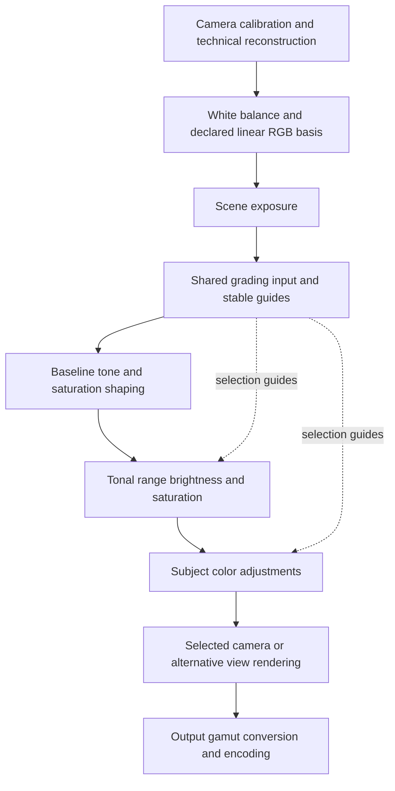

# Perceptual editing exploration

Research: [color and tone methods](../docs/color-and-tone-research.md).

The selected tone workflow is Exposure → spatial Dynamic range → Brightness/Contrast, with colorfulness and Color Editor handled separately. Clipping/rendering work and an ETTR-aware automatic baseline follow later. Earlier three-band tone proposals below are retained research context and are superseded by the approved Universal revision at the end. The owner authorized a first color and tone experiment, scoped in [Saturation](../docs/specs/saturation.md). No new default is selected.

Current behavior remains defined by [photographic finishing](../docs/specs/photographic-finishing.md), [tonal ranges](../docs/specs/tonal-ranges.md), [Color Editor](../docs/specs/color-editor.md) and [editor workflow](../docs/specs/editor-workflow.md). When a concrete slice is selected for implementation, record its agreed behavior in the relevant specification. Keep the wider research catalog independent of that slice.

## Owner goals

- Offer baseline color response, saturation adjustments by tonal range, and adjustments to specific colors. These are complementary controls.
- Provide a similarly understandable tonal workflow, starting with Exposure and then broad tonal ranges before individual colors.
- Prefer simple controls and fixed responsibilities initially. Avoid multiplying method selectors across controls.
- Keep photographic operations reusable across supported architectures while camera adapters retain required calibration, sensor corrections, noise cleanup and reconstruction.
- Work on color and tone first. Follow with clipping correction and automatic exposure.
- Support a useful preview baseline for Merrill photographs captured using expose-to-the-right, or ETTR. The owner should not need to reduce Exposure, Whites and Highlights manually for every photograph.
- Keep original X3Fs and authored settings as the editable source. DNG remains an edited derivative.

## Proposed editing workflow

### Base

Establish Exposure and the overall tone and color response. Keep White Balance as its existing independent preparation step. Retain global Contrast and a simple Saturation amount. Put the saturation-versus-saturation curve behind a compact curve disclosure so routine editing does not require drawing it.

The curve represents baseline saturation response, not a second unrelated saturation algorithm. The simple amount should scale that response. A neutral curve must be an exact bypass. Candidate presets such as a restrained natural boost are comparison proposals, not new defaults.

For tone, start with Exposure, global Contrast and an approachable brightness or midtone adjustment. A full tone curve can follow if the simpler controls cannot express the required result. Avoid exposing several global controls that all make nearly the same midtone change.

### Tonal ranges

Offer three linked groups: Shadows, Midtones and Highlights. Each has Brightness and Saturation. This repeats the existing compact amount/subparameter group pattern and leaves every authored value visible.

The owner's three-band audio EQ analogy describes the intended interaction: three broad gain controls with smooth crossover regions. Here the selection axis is brightness, rather than audio frequency or spatial feature size. A frequency-like control over image detail sizes belongs to the separate Contrast Equalizer concept.

Use smooth overlapping masks, with a preview of the affected range. A proposed invariant is that nonnegative range weights sum to one, so equal settings across all three bands match the corresponding global adjustment rather than becoming stronger in crossover regions. Define that equivalence in the selected adjustment domain, such as stops for exposure gains, rather than blending independently processed RGB results arbitrarily. Shared crossover controls should shape both neighboring bands together. Neutral settings must remain an exact bypass.

Keep range boundaries and falloff controls in an optional advanced area only if photographic review demonstrates a need. Blacks and Whites can remain advanced endpoint refinements if they add useful control beyond the three primary groups.

The existing four-slider HDR response is not equivalent to a three-range brightness model. It has coupled endpoint controls, a camera-dependent pivot and a spatial base. Decide how to evolve or retain that behavior through comparisons rather than relabeling its sliders or applying a second hidden Shadows/Highlights operation.

### Color Editor

Keep the familiar color swatches and Hue, Saturation and Brightness controls. The default workflow is a correction to specific subject colors after the broad image decisions. An affected-color preview and a picker are useful follow-ups. Advanced ranges, uniformity and palette harmonization remain separate later additions.

Monochrome must retain its sensor mixture and technical reconstruction. Color-derived selections still act on its resulting brightness. Hue and saturation retain their current inactive-value behavior in monochrome.

### Method choices

Start with fixed responsibilities for these three steps and one selected perceptual color operation. Do not provide RGB, Oklab, UCS and other selectors independently at every step. Evaluate Oklab as the smallest extension of the existing code and compare darktable UCS where brightness-aware saturation or gamut-relative shaping warrants its additional machinery. Neither is selected by this exploration.

The camera/reference versus alternative rendering decision is a separate base-rendering choice. Existing Reference behavior and saved recipes must not change silently. If evaluation justifies another rendering model, expose it once at that boundary. Determine saved-edit migration explicitly before changing numerical meanings or positions. Avoid speculative compatibility branches.

## Proposed processing structure

UI order expresses an editing workflow. It does not make panel dragging change graph execution order. Camera calibration, required reconstruction and signal geometry remain camera-owned. Shared numerical operations consume declared primaries, white normalization and geometry.

The candidate order for the new shared approach is:

This is a candidate photographic order. It differs from the current graph, where Color Editor precedes HDR and Universal global saturation follows camera appearance. Compare those positions explicitly before selecting a replacement. Preserve existing Local Contrast, reconstruction detail and sharpening responsibilities while evaluating their placement separately.

Use a common perceptual operation for colorfulness changes in Base, Tonal Ranges and Color Editor. Vary its weights according to starting saturation, tonal range or subject hue. Keep selection separate from the adjustment so a correction does not move pixels into and out of its own selection. Color-model conversion alone does not make different strength mappings equivalent.

Freeze tonal and hue selection guides at a declared input to the new grading stack. A tonal guide should account for Exposure and the intended rendering pivot, then remain independent of downstream range adjustments. Hue classification should retain the cleaned neutral color guide's independence from creative changes and monochrome mixing. Selection stability and the desired interaction with baseline tone remain evaluation points.

Reuse guided-filter and retained-input infrastructure where the numerical meanings match. Selection smoothing must not become extra image denoising. Preserve exact neutral bypasses, immutable source buffers, bounded interactive reuse, inspection, and matching Full, reduced and regional rendering support. Do not rerun camera reconstruction for a downstream color change.

## Later clipping and output work

Use the [highlight and output research](../docs/color-and-tone-research.md#highlight-and-output-considerations) to separate reconstruction, negative handling, view transforms and DNG reader behavior. Select a concrete investigation after the first color and tone comparisons. Preserve camera clipping provenance and identify what appearance is baked versus carried by metadata before changing export policy.

## ETTR-aware baseline exposure

The goal is to preview the captured scene at useful midtone brightness with pleasing highlights. ETTR capture seeks signal quality at acquisition. It does not imply that the brightest pixel should become display white or that the average scene should always become middle gray.

The proposed first interaction is a one-shot **Auto baseline** action. Show and save its resulting ordinary settings so manual edits and reset remain understandable. Continuous automatic correction during slider edits is outside the initial proposal. Whether to apply this automatically to new images is a later defaults decision.

Estimate from a bounded whole-image reduction of the corrected photographic signal. Do not meter the current viewport or let the result depend on Smart crop size. Use a declared ungraded baseline and keep a previous automatic result from feeding back into its own measurement. Exposure changes should reuse reconstructed data.

An initial candidate solver has two distinct goals:

1. Estimate a robust midtone placement. A starting calculation is `EV = log2(target / measured)`, where the target and measurement policy still require evaluation.
2. Evaluate the resulting highlights through the selected rendering. Control broad highlight compression while allowing small specular peaks to remain bright.

Use robust luminance statistics and high-percentile information rather than the single brightest pixel. Keep truly clipped samples and unreliable shadows from dominating the estimate. A high-key subject, dark interior, colored light or backlit portrait needs evaluation beyond a generic histogram target.

The preferred eventual design lets Auto set exposure while the selected rendering supplies a suitable shoulder from the scene range. With the existing camera rendering, achieving the same preview might also require bounded Highlights/Whites changes. Compare these alternatives before choosing. Do not hide those corrections in an unexplained Exposure value or routinely darken an entire portrait to contain a tiny reflection.

Changing Exposure cannot recover signal that clipped at capture. Auto should distinguish protecting captured headroom from repairing missing information. It should operate after technical reconstruction and before creative grading, with explicit handling of camera-relative exposure normalization.

## Work sequence and evaluation

| Order | Work | Decision before implementation |
| --- | --- | --- |
| 1 | Match global and targeted colorfulness behavior through a shared perceptual foundation. | Choose the preserved perceptual quantity, normalization and gamut policy through comparisons. |
| 2 | Evaluate baseline saturation shaping and three tonal-range brightness/saturation groups. | Select curve strength mapping, masks and the relationship to existing HDR endpoints. |
| 3 | Refine the Color Editor's shared response and selection UX. | Decide picker and inspection scope without adding a second color science model. |
| 4 | Evaluate clipping correction, negative handling and view transforms. | Choose rendering alternatives and separate DNG sample defects from reader appearance. |
| 5 | Add the ETTR-aware automatic baseline. | Set metering targets, highlight policy and user-visible changes. |
| Later | Harmonizer, uniformity, opponent-color contrast, multiscale contrast and film rendering. | Add distinct tools only where photographic review demonstrates useful creative control. |

Use portraits, neutral ramps, muted pastels, vivid flowers, foliage, bright colored lights, specular reflections, clipped clouds, low-key interiors, high-key scenes and noisy shadows. Include both color and sensor monochrome on Merrill before expanding architecture coverage.

Compare exposure and saturation sweeps, not only isolated final images. Check neutral preservation, approximate hue/lightness stability, smooth curve and mask transitions, monotone tonal response where intended, near-black color stability, finite signed/headroom behavior and graceful gamut compression. Color that is truly neutral should not acquire hue through selection noise.

For integration, check cached/fresh equality, regional/full agreement, reduced/full guide consistency, edit-to-image latency and frozen batch settings. Evaluate DNG sample reprojection separately from TIFF appearance and downstream-editor review. Auto exposure should remain stable across preview qualities, ignore isolated extreme peaks, and avoid repeatedly changing a settled baseline.

## First experiment

- [x] Add one opt-in Perceptual experiment switch under Universal tone, retaining the existing methods and inactive values.
- [x] Share the existing Oklab chroma implementation between Color Editor and pre-curve global/range grading.
- [x] Add an editable four-node relative-colorfulness response and three fixed overlapping brightness/saturation bands.
- [x] Preserve section bypasses, presets, sidecars and frozen output settings through shared photographic controls.
- [x] Add scalar tonal-mask inspection and actual input/output comparisons.
- [x] Extend existing scalar and chromatic DNG baking paths to the new stage.
- [x] Complete original-photo, GPU, UI and native review checks and rebuild the local app.
- [ ] Owner review of color response, tonal selectivity and the next processing change.

The initial operation uses Oklab chroma scaling, matching Color Editor, rather than claiming full brightness-aware saturation or gamut-relative normalization. Its response curve uses relative Oklab chroma as a provisional axis. Exposure remains the main global brightness control. Band brightness is expressed in stops. Crossover masks are pointwise, fixed and measured before the grade. They sum to one. The camera/exposure-derived middle-gray pivot is reused from the existing HDR context.

The new grade precedes Color Editor. Global contrast and the selected camera response retain their existing positions. Enabling the experiment bypasses the old global saturation and four HDR controls. Their authored values are retained. This limits the first comparison to shared colorfulness and the tonal EQ, without silently replacing camera rendering, the existing spatial HDR filter or global contrast.

Next decisions follow photographic review of the response curve, six range controls and their interaction with the camera look. Rendering and automatic defaults remain later work.

Owner review rejected the initial band-brightness response as unintuitive, crushed and gray. A numerical trace found that its masked exposure offsets can reverse tone order in a crossover. A +2 EV shadow or midtone setting, or -2 EV highlight setting, gives a minimum log-brightness slope of -0.2. Normalized overlap and neutral checks did not catch this. The gray appearance still needs an image-specific downstream curve/clipping trace. Do not treat the initial brightness operation as photographically accepted.

The owner requested numerical study of basic color and tone operations before choosing a replacement. The [research catalog](../docs/color-and-tone-research.md#local-numerical-inspection) separates decoded code from reviewed and probed behavior. The studied pointwise three-way lightness response is a comparison candidate. Its tint-wheel saturation is not the requested neutral saturation of existing colors. A spatial filter is not automatically required by this comparison. No replacement or new default is selected by these findings.

Verification passed: workspace tests, strict Clippy, formatting, documentation indexes and artwork tests. GPU checks cover exact neutral output, signed values, normalized mask overlap, equal-band brightness and agreement with Color Editor's saturation operation. Original Merrill checks cover neutral equality, cached/fresh equality and effective section bypasses in color and monochrome. DNG reprojection passed on Merrill and Quattro originals. Native smoke captures cover the neutral grade, nonneutral grade, tonal mask, Color Editor and monochrome. The optimized app bundle is rebuilt for owner review. These checks establish numerical and integration behavior. Photographic response and crossover choices still need owner feedback.

## Research outcome before the next experiment

The local numerical inspection now establishes useful response families for global Saturation, Brightness, Contrast, Exposure protection, Levels, Curves, selected HSL corrections, three-way lightness, Dehaze and output gamut compression. It also reviews working-space boundaries, HDR, Clarity, White Balance and monochrome responsibilities. The [research catalog](../docs/color-and-tone-research.md#what-the-local-inspection-establishes) records mechanisms, native-check coverage and remaining limits.

The owner clarified that exact replication of the studied color and tone processing is unnecessary. Mature processing choices should inform our options. Stop expanding legacy-path or UI-equivalence work unless a selected experiment needs it. The packaged three-way Metal kernel and host lightness implementation differ. Both are documented as separate variants. They must not be combined into one claimed application formula.

Revisit the earlier proposals that every range must use the same adjustment and that all saturation controls must share identical math. A common conversion, selection and gamut foundation can support distinct photographic responses. A restrained global saturation operation, direct selected-color chroma control, and neutral-protected Lightness are useful candidates. An anchored monotone brightness curve is a more appropriate next tone comparison than the rejected independent band-EV response. These remain candidates awaiting an implementation decision.

Research added no processing changes or defaults. The completed standalone native checks cover 184 configurations. They isolate equations and selection behavior rather than asserting full application matching. Earlier HDR and monochrome probes are retained evidence and are excluded from that count. Documentation indexes and whitespace checks cover the research additions.

## Approved Universal tone revision

The owner selected Exposure for subject/midtone placement, optional spatial HDR for fitting the ends, then creative midtone/color shaping. Implement one anchored Brightness control alongside existing Contrast. Remove the rejected masked-EV brightness bands while retaining separate tonal saturation. The [finishing requirements](../docs/specs/photographic-finishing.md) define the selected control order, rational response, signed/headroom policy and DNG boundary. This implementation is inspired by the researched response families rather than a complete replica.

- [x] Retain all four spatial HDR controls independently of the saturation experiment.
- [x] Add one shared scalar Brightness stage after HDR with exact neutral omission.
- [x] Carry Brightness through saved edits, scoped settings, inspection and DNG baking.
- [x] Remove band-brightness arithmetic and controls. Ignore obsolete experimental band fields on load.
- [x] Check monotonic ramps, combined contrast, signed/color inputs and code-scale invariance.
- [x] Check original-photo DNG baking, cached/fresh output and native UI.
- [x] Complete workspace checks and rebuild the optimized app for feedback.

Earlier three-band brightness requirements and numerical checks describe the rejected first experiment. They are superseded by this revision. Defaults and Reference behavior remain unchanged.

Revision verification passed workspace tests, strict Clippy, formatting, documentation indexes and artwork tests. GPU ramps cover the full Brightness range, black/white anchors, signed/color samples, code whites of 1 and 4095, and composition with Contrast extremes. Original Merrill tests pass cached/fresh equality and combined HDR/Brightness/Local Contrast/sharpening DNG gain baking in Color and Monochrome. Native captures show the revised Universal controls, saturation masks, Color Editor and Monochrome without panel expansion. The optimized app bundle is rebuilt. Owner photographic feedback on Brightness strength and appearance remains pending.

Brightness classification includes the selected Exposure gain even though camera adapters apply that gain later with their tone response. Transfer only its scalar curve gain to the unexposed samples. This keeps tonal selection aligned with exposure without applying Exposure twice and uses the same rule in DNG baking.

## Saturation feedback and numeric display policy

The owner prefers ordinary Universal Saturation's restrained positive boost and reports hard clipping with the perceptual option. The prototype scales Oklab chroma directly and has neither a muted-color boost taper nor gamut compression. It runs before the camera response, where negative RGB components are clamped at the tone-table boundary. This is a concrete clipping route. Approximate perceptual hue/lightness coordinates alone do not provide gamut safety. Keep ordinary Saturation available. No replacement saturation algorithm is selected by this feedback.

Numeric control construction now belongs to shared Slider/DragValue factories with one significant-digit policy. Production call sites no longer attach their own formatters. Field widths use the same policy. Defaults apply to both themes and disable built-in full-precision hover hints. A production-source boundary test prevents future raw numeric widget or custom-formatter call sites. Generic widget tests cover fractional/exponent values, integer values, both themes, construction without workspace style and unchanged stored precision.

The owner's screenshot clarified that the layout problem includes extra decimal places such as `0.007`, even though that value has fewer than three significant digits mathematically. The shared policy now enforces both at most three significant digits and at most two decimal places. Thus `0.007` displays as `0.01`. Compact scientific notation retains a visible nonzero value where two decimal places would otherwise show zero. Stored values remain unchanged. Tests include the reported case.

Verification passed workspace tests, strict Clippy, formatting, documentation indexes and artwork tests. The reported `0.007` case passes in the rendered Universal controls with unchanged settings. Native smoke checks pass with the rebuilt optimized app and show the shared two-decimal readout in the perceptual saturation field.

## Approved perceptual saturation correction

The owner authorized fixing the perceptual saturation experiment. Retain its placement, saved controls and additive global/response/band selection. Replace unrestricted positive chroma scaling with a restrained gain based on the available working RGB gamut at fixed Oklab lightness and hue. Negative adjustments retain their direct desaturation response. Color Editor retains its existing direct controls and shares only the conversion primitives. This supersedes the prototype's positive response described above.

Compute RGB bounds from nominal black/white, expanding them to retain existing signed values, headroom and the fixed-lightness neutral. Each RGB component is cubic along the Oklab hue ray. Split the boundary search at derivative roots so it cannot skip a narrow out-of-gamut region near blue. Use stable quadratic roots and scalar polynomial evaluation. The boundary restricts new positive saturation rather than independently clamping RGB or replacing final display gamut mapping. Existing colors beyond the first boundary retain their input under positive saturation. The response curve's selection axis remains the original relative-chroma proxy, distinct from gamut occupancy used by the boost.

- [x] Check three working RGB spaces, black/white edges, muted/vivid colors, hue/lightness preservation, signed/headroom samples and code-scale invariance on the GPU.
- [x] Check additive controls, monotonic positive strength and unchanged neutral/desaturation behavior.
- [x] Check original-photo cached/fresh output and chromatic DNG reprojection.
- [x] Complete workspace checks and rebuild the optimized app for photographic feedback.

Verification passed all workspace tests, strict Clippy, formatting, documentation indexes and artwork tests. Four perceptual GPU tests cover positive boosts up to the maximum combined contributions, all three working spaces, preserved lightness/hue, neutral and direct desaturation, additive selections, code-scale invariance and signed/headroom envelopes. Four existing Color Editor GPU tests pass after extracting the shared inverse-conversion primitives. Original Merrill cached/fresh and DNG reprojection tests pass. Native smoke captures pass with the optimized app. Bump the preview format identity so earlier rendered previews cannot retain the previous saturation response. Photographic strength and final display-gamut behavior remain for owner feedback.

### Palm-leaf feedback

The owner reports very weak positive response on `_P1M0138.X3F` in Import, with unsaved edits. No source-side recipe exists. An isolated read-only comparison using recorded Sunlight/Standard defaults confirms asymmetry but does not reproduce a wholly inactive positive adjustment. With global, response and tonal contributions all at +1, about 85% of regularly sampled physical-raster pixels change. About 15% remain protected. The file contains pre-curve negative channels and samples above nominal white. The boundary policy can freeze those samples under positive adjustment even when later exposure and camera rendering produce useful visible colors.

The response selection and boost restraint also use different colorfulness measures. On this file, about 97% of sampled pixels above the near-black cutoff lie in the first two thirds of the provisional response-curve axis. Consequently the Vivid node affects little of the image. The gamut-relative occupancy already computed for restraint is distinct from that provisional curve axis. A follow-up should review an exposure/look-aware boundary and a coherent response-selection scale before changing strength or pipeline placement. The owner's unsaved settings were unavailable, so this comparison does not establish an exact match to their current viewport. No further processing change has been selected or implemented from this feedback.

## Approved two-slider saturation experiment

The owner selected two ordinary sliders instead of colorfulness buckets or a crossing range control. Saturation changes overall colorfulness. Positive amounts favor muted colors while protecting vivid colors. Negative amounts reduce vivid colors preferentially. Saturation Contrast spreads colorfulness when positive and brings muted and vivid colors closer together when negative. Both are neutral-centered. Retain optional saturation by tonal range. Ordinary Universal saturation and Reference remain available through the existing selection.

Reuse the existing pre-curve node, retained input, color conversion and working-gamut boundary. Replace the provisional response axis and four-node curve with one gamut-relative coordinate shared by the two controls. A monotone cubic changes saturation contrast around half occupancy. A bounded rational response then changes saturation. Near-neutral contrast amplification is limited to two. This follows the [saturation requirements](../docs/specs/saturation.md), not an exposure-aware boundary redesign. The conservative pre-curve boundary remains for photographic review. Removed response fields are discarded on read and omitted from new saves, as with the superseded experimental brightness bands.

Numerical checks also found a wide-gamut desaturation target can land in a gap along the fixed-lightness hue ray. Such targets reduce chroma to the first reachable boundary rather than adding independent-channel clipping. Ordinary in-gamut colors preserve hue and lightness. The two-slider response is monotone within the connected gamut.

- [x] Replace bucket UI, curve arithmetic and saved control with Saturation Contrast.
- [x] Check muted/vivid response, contrast direction, gamut bounds and bounded neutral amplification on the GPU.
- [x] Check settings, section presets, GUI formatting, cached/fresh rendering and DNG reprojection.
- [x] Rebuild the optimized app and review native captures and the palm-leaf original.
- [x] Complete workspace, documentation and artwork checks.

Verification passed seven GPU tests covering both control directions, all three working spaces, code-scale invariance, neutral preservation, full desaturation, additive tonal amounts, signed/headroom handling and monotone fixed-lightness chroma ramps across 25 slider combinations. Saved-setting, scoped-tool and GUI checks carry Saturation Contrast and enforce the shared readout policy. Original Merrill cached/fresh and DNG reprojection checks pass with both controls active. Native smoke captures show the simplified UI. Read-only comparisons of the palm-leaf original confirm finite output and visible changes in both contrast directions with recorded Sunlight/Standard settings. No source edits or sidecars were written by those comparisons. The existing pre-curve protection still limits already saturated or out-of-range colors.

Workspace tests, strict Clippy, formatting, documentation indexes and artwork checks pass. One asynchronous preview-clear test exceeded its shared timeout during parallel compilation. Its isolated retry and the complete workspace rerun passed without a cache-code change. The optimized bundle is rebuilt. Photographic appearance and strength remain for owner feedback.

## Rejected stronger saturation range

The owner finds the two-slider effects coherent and requests more range. Retain normalized -1..1 controls, exact neutral and gamut bounds. Extend positive Saturation so +1 allows up to four times very-muted chroma rather than two. Preserve the small-adjustment slope with the positive boost mapping `s*(1 + 2*s)`. Negative Saturation already reaches monochrome and retains its endpoint and response. Compose the monotone saturation-contrast curve a second time with the cubed control amount. This strengthens both ends without making small nudges equally stronger. Contrast's near-neutral amplification is bounded by four, and the two global controls together by sixteen.

The owner initially approved photo-relative creative selections because a photo’s colors and tones need not fill their theoretical ranges. A whole-photo percentile prototype passed numerical and original-photo cache/DNG checks, but the owner preferred the gamut-based response. Remove the prototype, its histograms, reference preparation/cache, kernel, tests and UI descriptions. Retain the contrast pivot at half working-gamut occupancy and the original camera/exposure-relative tonal crossovers. Keep the independently requested stronger range. The rejected prototype must not remain as a hidden option or additional render work.

- [x] Check stronger endpoint response, monotone curves and gamut bounds.
- [x] Rebuild the optimized app and complete rendering, DNG, GUI and workspace checks.

The restored gamut-based implementation passes seven GPU tests, including endpoint-strength regressions, 25 slider combinations on a fixed-lightness chroma ramp, all three working spaces, signed/headroom handling and exact neutral bypass. Original Merrill cached/fresh and DNG reprojection checks pass. Workspace tests, strict Clippy, formatting, documentation indexes and artwork checks pass. Native captures pass with the rebuilt optimized app. The automatic-analysis prototype is absent from processing, rendering, kernel registration and settings. Appearance at the extended endpoints remains for owner feedback.

The owner also rejected the extended range. Restore the original single saturation-contrast curve and positive gain `(1 + amount)/(1 + amount*colorfulness)`. Retain the two sliders, gamut-based midpoint, original tonal crossovers, vivid-first negative Saturation and existing gamut protection. Remove the extra contrast application, positive boost remapping and extended-strength assertions. The original limits again bound near-neutral amplification to two for either global control and four together. Keep no hidden choice for the rejected response.

The strength rollback passes all seven perceptual GPU tests, workspace tests, strict Clippy, formatting, documentation indexes and artwork checks. The optimized app is rebuilt with the original two-slider response.

## Saturation closeout

The owner selected separate Tone, Saturation and Color Range sections. The concrete scope is recorded in [Saturation](../docs/specs/saturation.md) and tracked in the [closeout plan](./archived/saturation-closeout.md). Universal saturation retains the accepted fixed-gamut two-slider response and overlapping tonal saturation masks. Its method is independent of Tone. The Color Range swatches retain their existing HSL response. Saved experimental edits receive no migration. Wider tone, highlight-rendering and automatic exposure research remains separate.
